# Рубликс

Учебный симулятор инвестиций: виртуальный портфель, покупка и продажа акций,
графики, статьи и финансовые мини-игры. Все деньги и тарифы — демонстрационные,
реальных сделок и платежей нет.

Идея Рубликса — дать подросткам возможность разобраться в деньгах через собственный
опыт. Здесь можно настроить своего персонажа, собрать первый виртуальный портфель
и увидеть, как покупка акций меняет его состав. Ошибки остаются частью обучения:
своими деньгами рисковать не нужно.

Короткие миссии объясняют основы рынка, а игры помогают закрепить их на практике:
ответить на финансовый вопрос, выбрать действие в заданной ситуации или заметить
риск резкого падения цены. Рубликс сочетает учебный материал с игровой средой,
в которую можно зайти на несколько минут и постепенно разобраться в новых темах.

Внутри: торговля акциями на учебном счёте, свечи и объёмы, аналитика,
статьи, викторина рынка, дневной квиз, финансовые ситуации, раннер и раг пул.
На главной — текущая учебная миссия; шесть коротких разборов заканчиваются вопросом и переходом к практике.

## Экраны приложения

Главная на компьютере:

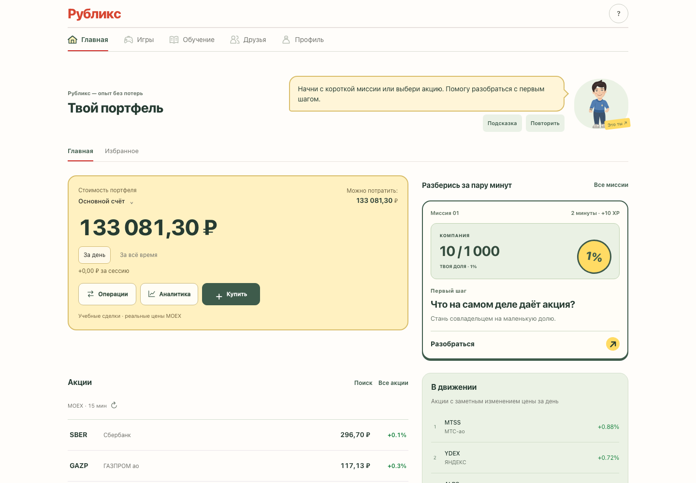

Мобильные экраны: учебный счёт, график акции, игры и обучение.
На свежих скриншотах — цены MOEX с задержкой 15 минут; деньги на счёте виртуальные.

<p>
  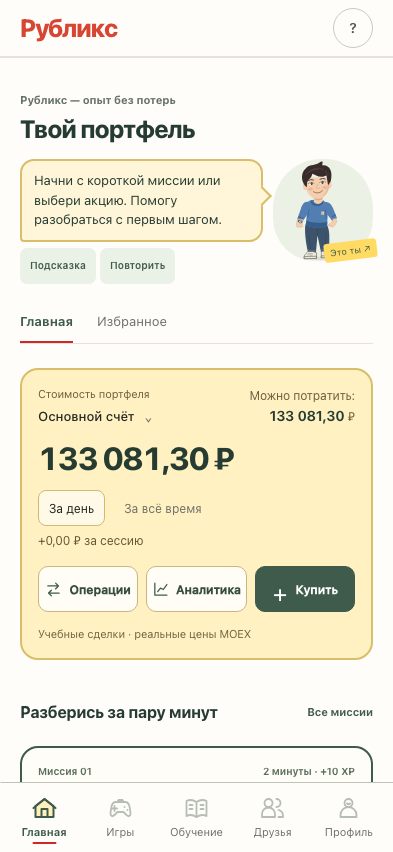
  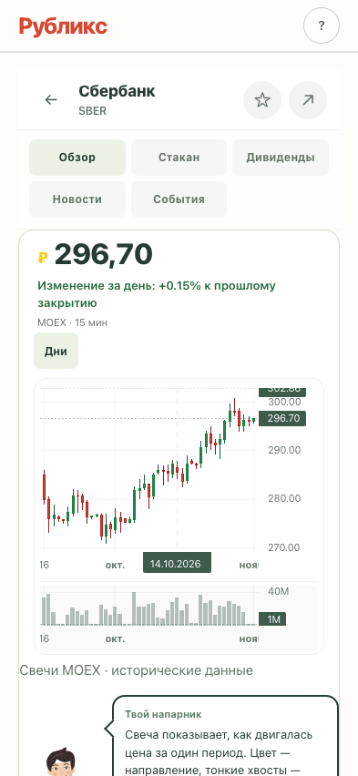
  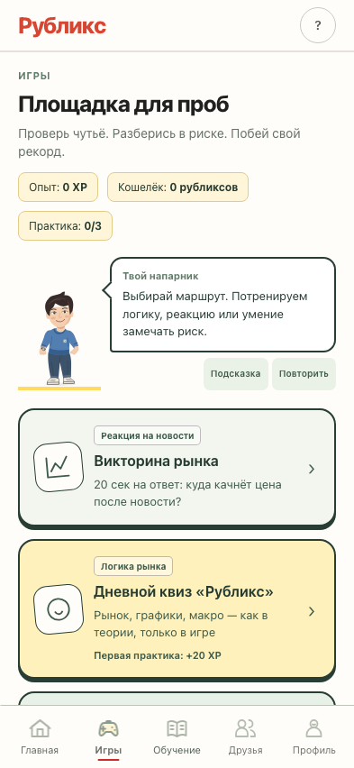
  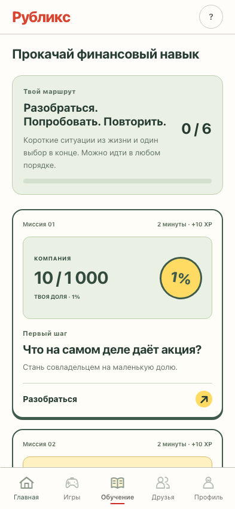
  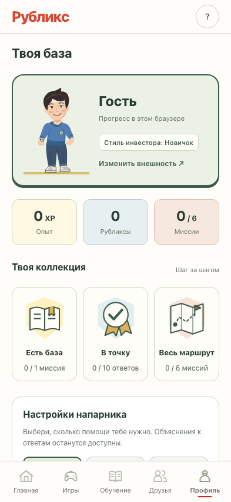
  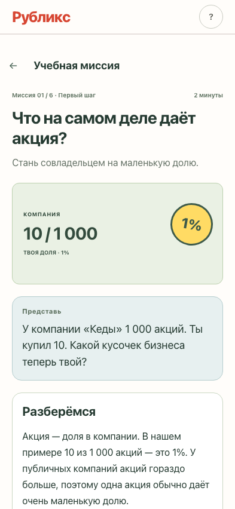
</p>

Своего персонажа можно настроить в редакторе:

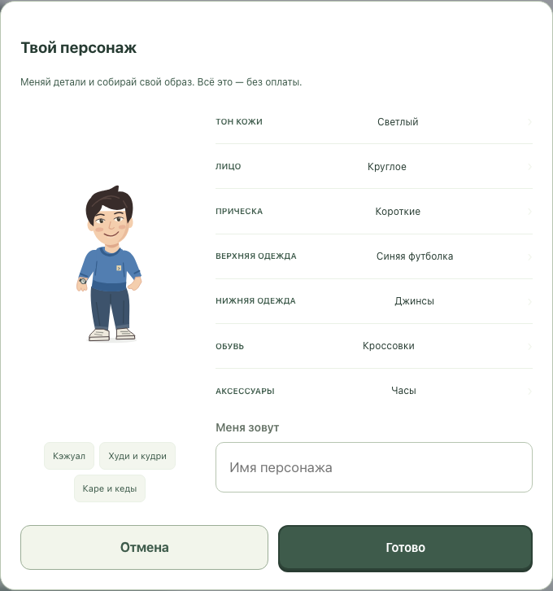

Персонаж тоже участвует: машет при встрече, прячет монетку после покупки,
показывает чек после продажи, радуется правильным ответам и чешет затылок при ошибке.
В гардеробе примеряет кеды и пританцовывает в наушниках, а в раннере двигает руками
и реагирует на прыжки и столкновения. В играх он объясняет ответы в речевых баблах,
двигает губами, показывает нужные плашки и даёт подсказки по кнопке.
Текст появляется по словам; его можно раскрыть сразу или повторить. В профиле есть режимы «С подсказками», «По запросу» и «Выключен». Системное уменьшение движения учитывается.

В раг пуле доступны готовые суммы, проценты банка и свой ввод; кнопка выхода всегда
под рукой, незаконченный раунд сохраняется. В раннере работают прыжок, удержание
приседания, клавиатура и пауза. В викторине объяснения переключаются вручную.
Прогресс трёх практик виден в игровом меню. Первая завершённая попытка квиза,
финансового выбора и пробежка с монетой дают XP и рубликсы; повторные попытки доступны свободно.

<p>
  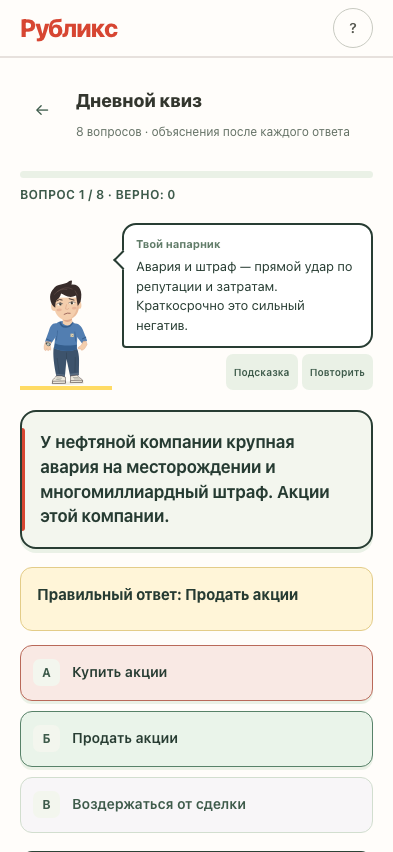
  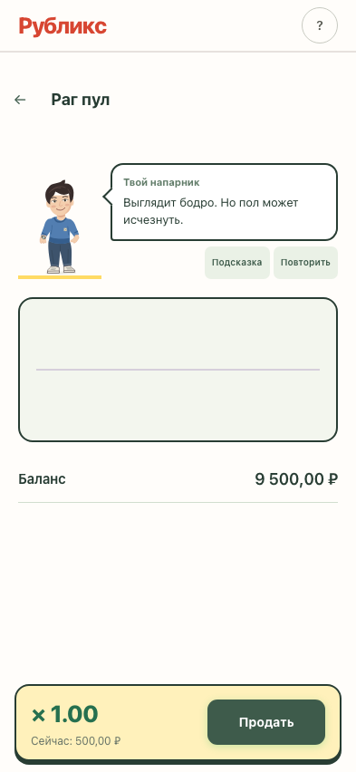
  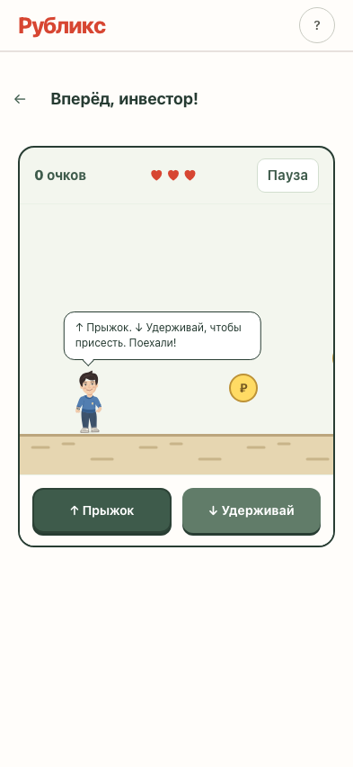
</p>

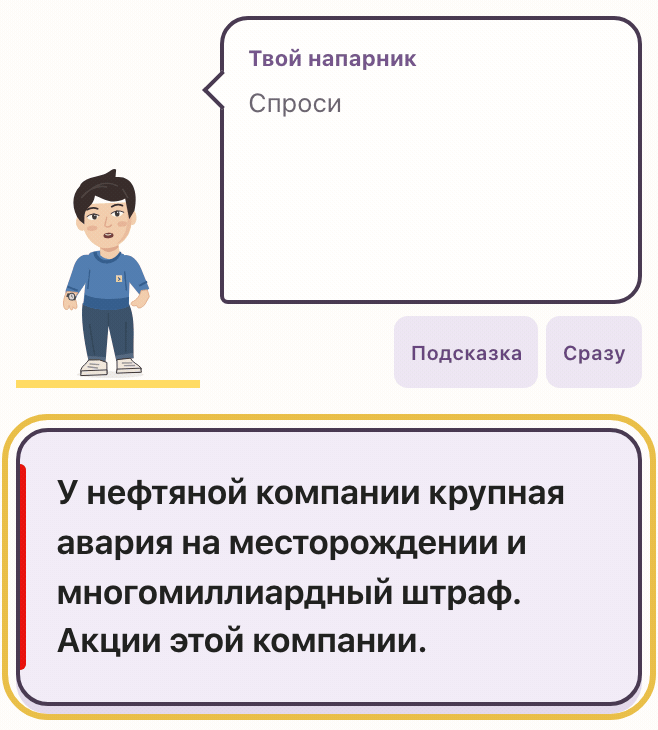

Источники и решения по дизайну: [docs/PLAY_EXPERIENCE.md](docs/PLAY_EXPERIENCE.md).

## Запуск сайта

Нужен **Node.js 22+**. Из корня проекта:

```bash
npm ci
npm start
```

Откройте [localhost:3000](http://localhost:3000). Один сервер отдаёт сайт и API.
Для телефона в той же Wi-Fi сети используйте `http://IP-компьютера:3000`.
Другой порт: `PORT=8080 npm start` (macOS/Linux).

По умолчанию включён гостевой режим: прогресс хранится в браузере в localStorage.
При очистке данных браузера прогресс удаляется. Котировки запрашиваются с MOEX ISS;
через сервер с кешированием. Бесплатные данные идут с задержкой 15 минут.
При сбое показывается недоступность или сохранённая цена; сделки по устаревшей цене
не исполняются. Вымышленные котировки автоматически не включаются. Полный стакан
требует отдельного доступа MOEX; дивиденды не начисляются. Шрифты, графики,
персонаж и шесть учебных миссий поставляются в репозитории.

Для серверных аккаунтов в `web/index.html` установите `RUBLIKS_LOCAL_ONLY = false`
и `RUBLIKS_GUEST_ONLY = false`. API по умолчанию находится на том же адресе.
SQLite-база создаётся автоматически в `server/rubliks.db`; в Git она не включается.
Это демонстрационный API: баланс и статистику отправляет клиент, поэтому он не
предназначен для реальных денег или защищённых соревнований.
Сервер ограничивает викторину 25 раундами в день независимо от демо-тарифа.
Резервная копия данных аккаунтов — файл базы; путь можно изменить через `RUBLIKS_DB_PATH`.

Настройки дизайна, обучения и источников данных: [docs/UX_MVP.md](docs/UX_MVP.md).

## Проверки

```bash
npm run check
npx playwright install chromium webkit
npm test
```

Тесты запускают отдельный сервер с временной базой. Проверяются Chrome на ПК,
Android, WebKit с экраном iPhone и ширина 320 px. Покрытие включает игры, сделки,
сохранение, счета, графики, ошибочные данные и API. GitHub Actions выполняет те же проверки.
Подробности и границы проверки — в [docs/QA.md](docs/QA.md).

## Структура

- `web/` — сайт на HTML, CSS и JavaScript; сборка не требуется.
- `server/` — Express API и SQLite (sql.js).
- `tests/` — браузерные и API-проверки.
- `Rubliks/`, `Rubliks.xcodeproj` — отдельный прототип iOS на SwiftUI (iOS 16+).
  Откройте проект в Xcode и выберите установленный симулятор.
- `docs/` — планы и спецификации; часть описывает будущие функции.

Сборки, зависимости, пользовательские базы, архивы и исходные бизнес-документы
исключены из Git. Библиотеки в `web/vendor/` содержат лицензии правообладателей.
